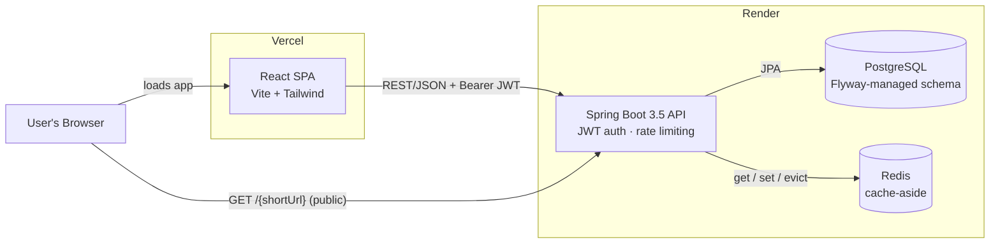
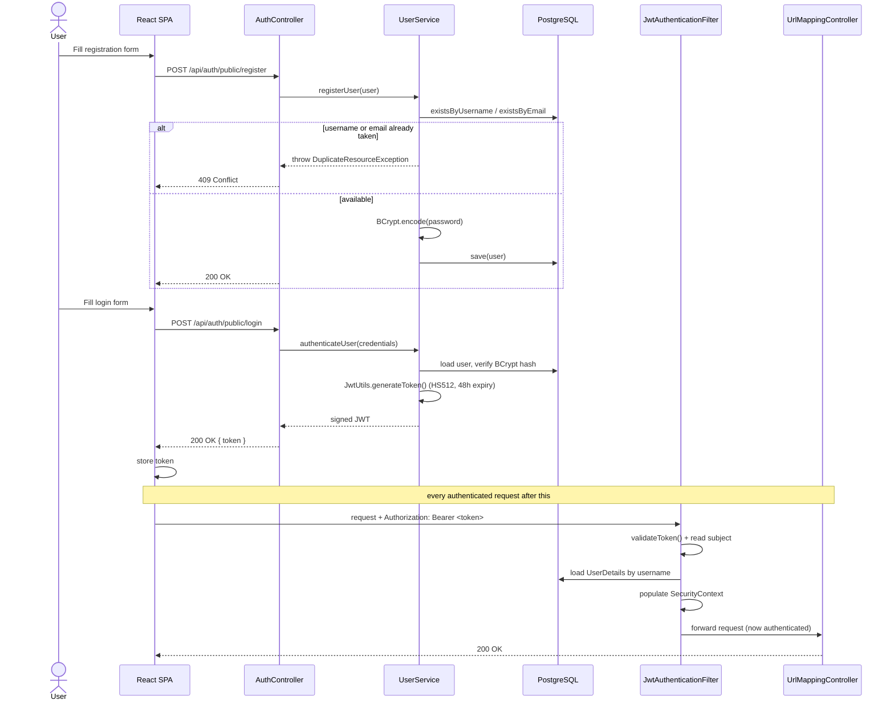
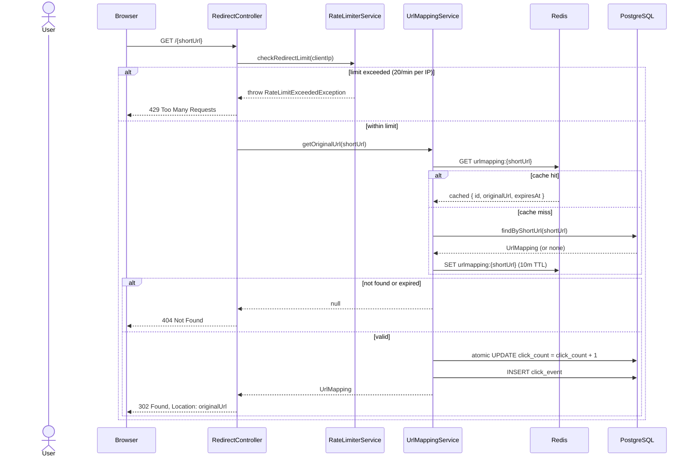

# SnapURL

A full-stack URL shortener with click analytics, link expiration, Redis caching, and rate limiting.

- **Frontend**: React (Vite) + Tailwind, deployed on Vercel
- **Backend**: Spring Boot 3.5 (Java 21) REST API, deployed on Render
- **Database**: PostgreSQL, schema managed by Flyway
- **Cache**: Redis, cache-aside in front of the redirect lookup
- **Docs**: OpenAPI/Swagger UI at `/swagger-ui.html`

For backend setup and the full API reference, see [`Url-Shortner-sb/README.md`](Url-Shortner-sb/README.md).

## Architecture

Two very different traffic shapes hit the same service: authenticated management calls from the SPA (`/api/auth/**`, `/api/urls/**`), and high-volume, unauthenticated redirects (`GET /{shortUrl}`) — which is why the redirect path gets its own cache and its own, more generous rate limit.

## Auth flow

Registration, login, and how the issued JWT is validated on every subsequent authenticated request.

## Redirect flow

The hot path: rate-limited per IP, cache-aside in front of the database, and click tracking that runs on every request regardless of whether it was a cache hit.

Client IP is read from `X-Forwarded-For` first, falling back to the raw connection address — necessary because Render's reverse proxy sits in front of the app, so the raw connection address alone would just be the proxy's IP.
